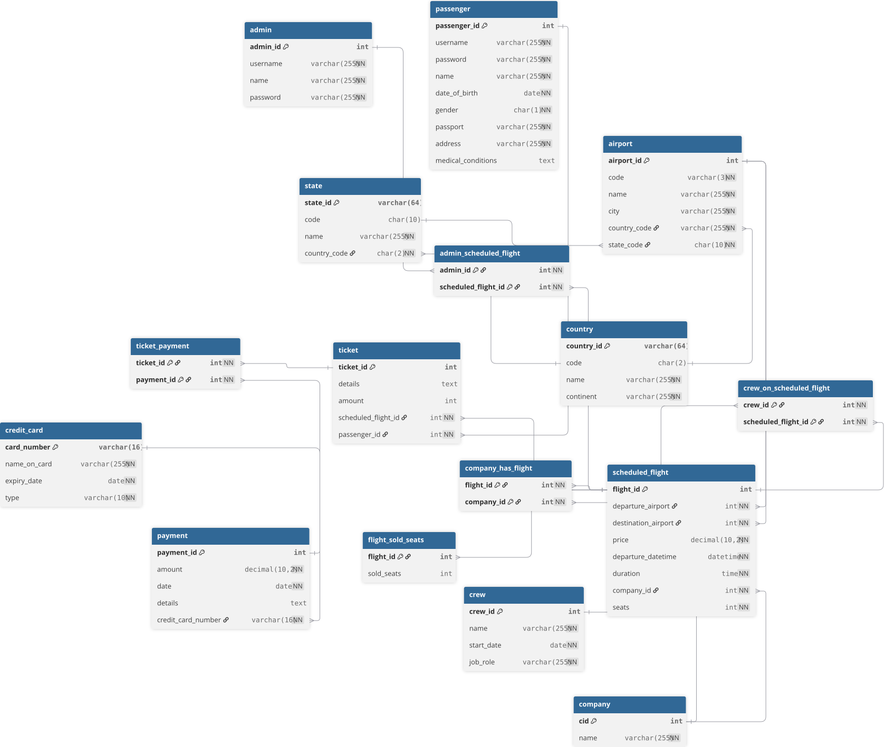

# Airplane Management System

A relational database-driven airline management system, with business logic implemented entirely in MySQL through stored procedures, triggers, and functions. A Java Swing desktop application provides the interface.

---

## Features

### Admin
- Add, update, and cancel scheduled flights
- Assign and remove crew members from flights
- View all passengers on a specific flight
- View all bookings across the system
- Visual analytics — company performance bar chart

### Passenger
- Register and log in
- Browse available flights
- Book a ticket (prevented from double-booking)
- Update or cancel an existing ticket
- View personal booking history

---

## Database Design




The schema is built around a normalized relational model covering:

| Table | Purpose |
|---|---|
| `airport` | Airports with IATA codes, city, country |
| `company` | Airline companies |
| `scheduled_flight` | Flight instances with route, price, seats, datetime |
| `flight_sold_seats` | Tracks sold seats per flight — intentionally maintained via triggers rather than application code to guarantee consistency at the DB level |
| `crew` | Crew members and their roles |
| `passenger` | Registered passengers |
| `ticket` | Booking records linking passengers to flights |
| `payment` / `credit_card` | Payment information |
| `crew_on_scheduled_flight` | Many-to-many: crew assignments per flight |
| `admin_scheduled_flight` | Tracks which admin created which flight |

### Stored Procedures
- `add_new_flight` — validates airports, checks for duplicate IDs, inserts flight
- `update_flight` — prevents reducing seats below already-sold count
- `delete_flight` — validates existence before deletion
- `add_crew` / `delete_crew` / `add_crew_to_flight` / `delete_crew_from_flight`
- `create_a_new_ticket` — prevents duplicate bookings per passenger per flight
- `update_ticket` — validates available seat count before updating
- `delete_ticket` — validates booking exists before cancellation
- `get_all_tickets` — retrieves full booking history for a passenger
- `get_all_passengers` — retrieves all passengers on a given flight
- `get_ticket_total_of_passenger` — aggregate ticket count per passenger

### Triggers
- `flight_sold_seats_after_insert_scheduled_flight` — initializes sold seat tracking when a flight is added
- `company_flight_after_insert_scheduled_flight` — keeps `company_has_flight` table in sync
- `update_flight_sold_seats_after_insert_ticket` — increments sold seats on booking
- `update_flight_sold_seats_after_delete_ticket` — decrements sold seats on cancellation
- `update_flight_sold_seats_after_update_ticket` — adjusts sold seats on ticket update

### Functions
- `passenger_exists(username)` — returns boolean, used for login validation

---

## Tech Stack

| Layer | Technology |
|---|---|
| Language | Java (JDK 13) |
| UI | Java Swing (IntelliJ GUI Designer) |
| Database | MySQL 8 |
| JDBC Driver | mysql-connector-j 8.0.32 |
| Charts | JFreeChart |

---

## Setup

### Prerequisites
- Java 13+
- MySQL 8+
- IntelliJ IDEA (recommended) or any Java IDE
- mysql-connector-j and JFreeChart JARs on the classpath

### 1. Import the Database

```bash
mysql -u root -p < src/airplane_management_final.sql
```

This creates the `airplane_management` database with schema, stored procedures, triggers, and sample data.

### 2. Configure the Connection

When the application starts, you will be prompted for your MySQL username and password via the login screen. The default host is `localhost:3306`.

### 3. Run the Application

Open the project in IntelliJ IDEA and run `src/Main.java`, or compile and run from the command line:

```bash
javac -cp .:mysql-connector-j.jar:jfreechart.jar src/Main.java
java -cp .:mysql-connector-j.jar:jfreechart.jar Main
```

---

## Project Structure

```
src/
├── Main.java                        # Entry point
├── AirplaneManagementUI.java        # Main window
├── airplane_system.sql              # Schema definition
├── functions.sql                    # Stored procedures, triggers, functions
├── airplane_management_drump.sql    # Full database dump with sample data
├── java_connect/
│   ├── DBConnector.java             # MySQL connection setup
│   └── JavaMySql.java              # Query execution helpers
├── home/
│   ├── LoginPage.java
│   └── SignupPage.java
├── admin_operation/
│   ├── AdminPage.java               # Admin dashboard
│   ├── AddCrewPage.java
│   ├── AddCrewToFlightPage.java
│   ├── ViewBookingPage.java
│   └── ShowPassengersOnFlight.java
├── passenger_operation/
│   ├── PassengerPage.java           # Passenger dashboard
│   ├── SearchFlightPage.java
│   ├── PlaceOrderPage.java
│   └── CheckMyOrdersPanel.java
└── visualization/
    └── BarChartCompanyPerformance.java
```

---

